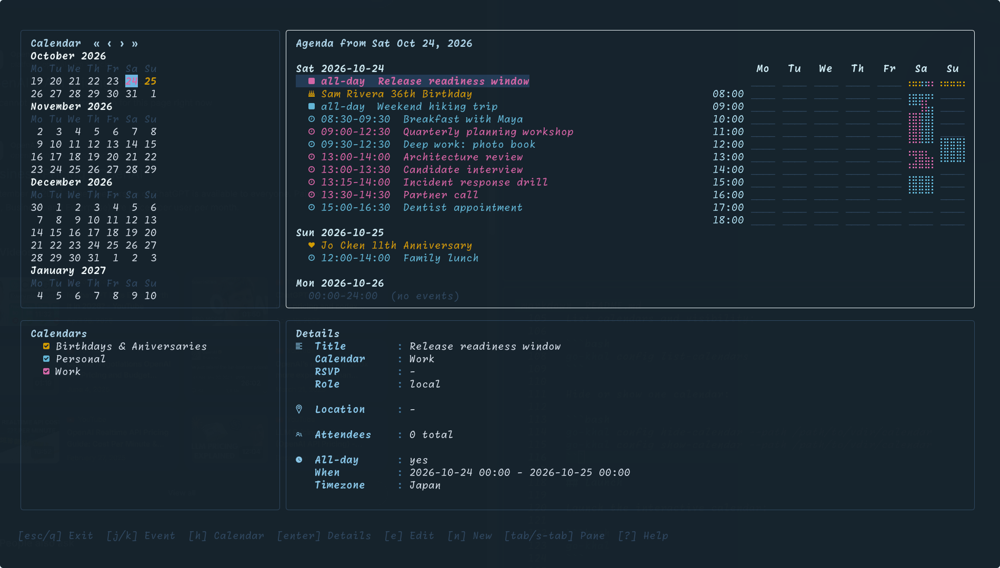
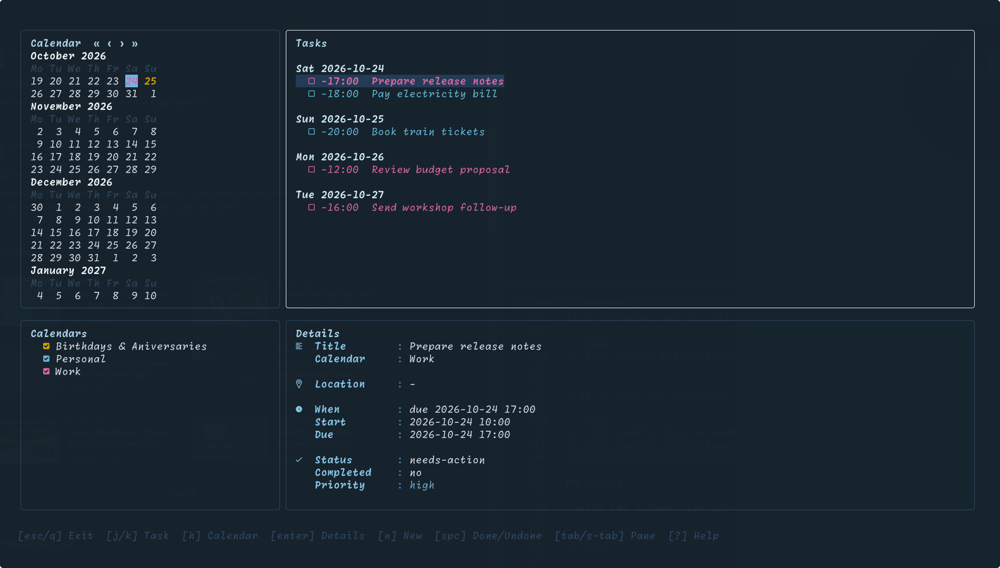
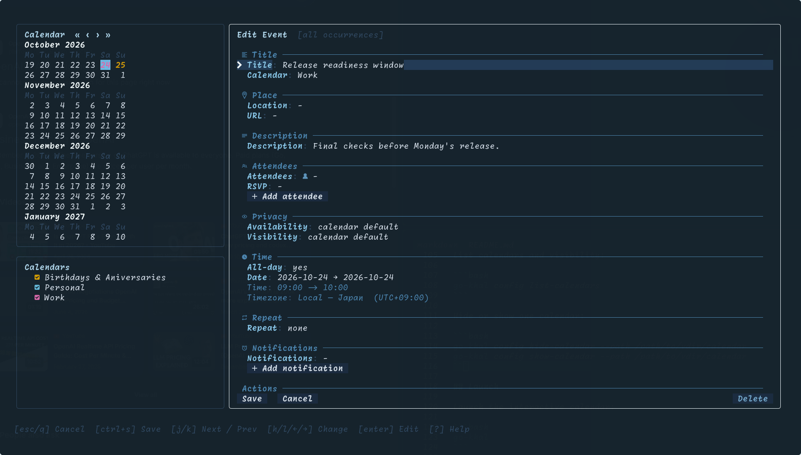
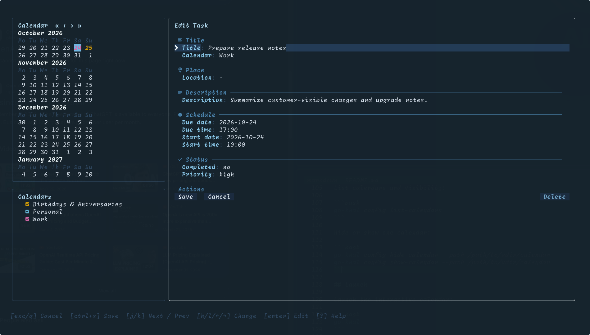

# go-khal

`go-khal` is a terminal calendar and task manager inspired by
[pimutils/khal](https://github.com/pimutils/khal). It reads calendars and todos
from local vdir directories (for example, synced by
[vdirsyncer](https://github.com/pimutils/vdirsyncer)) and renders an interactive
agenda with calendar visibility controls, event details, and task management.

## Status

Use `go-khal` at your own risk, especially when editing or deleting events and
tasks. These operations write directly to local `.ics` files and bugs may result
in data loss. Keep backups or use versioned/synced calendar directories before
trying destructive operations. I use it personally with Radicale and Google calendars
without issues but cannot guarantee there won't be issues with other calendars.

## Features

- Keyboard- and mouse-driven terminal calendar with months list, agenda, details pane, and calendar toggles
- Google Meet links provide Join and Copy controls; Microsoft Teams and Zoom links open through the operating system's default app
- Event Location and URL fields containing web links provide Open and Copy controls while preserving their original text
- Minimap with a weekly overview: click events to jump to them, or click empty time to stage a one-hour slot for `n`
- Separate agenda and task modes, agenda page movement, and show-all mode
- Event and task create/edit/delete support from the interactive calendar, with
  confirmed destructive actions in edit forms
- Event attendees auto-completion from VCARD contacts.
- Birthday events from VCARD contacts.
- Configurable calendar and addressbook sources that point directly at
  [vdirsyncer](https://github.com/pimutils/vdirsyncer) folders
- Per-calendar metadata (display name, color) including discovery from `displayname`/`color` files
- Per-calendar show/hide controls to include/exclude all events and todos
- Optional Nerd Font glyphs for the richest terminal rendering
- Automatic Omarchy Quattro palette support with live theme reloads.

## Installation

Requirements:

- Local vdir calendar/task/contact data, commonly synced by
  [vdirsyncer](https://github.com/pimutils/vdirsyncer)
- A terminal that supports color and alternate screen applications
- A Nerd Font-compatible terminal font is recommended
- `$EDITOR` or `$VISUAL` is used for description editing with `ctrl+e`; if neither is set, `nano` is used

### Install From Release Binaries

Download the archive for your platform from the [GitHub releases page](https://github.com/hsanson/go-khal/releases).

Release artifacts are named by version, OS, and CPU architecture, for example
`go-khal_v0.7.0_linux_amd64.tar.gz`, `go-khal_v0.7.0_darwin_arm64.tar.gz`, and
`go-khal_v0.7.0_windows_amd64.zip`.

Linux x86_64 example:

```bash
export VERSION=0.7.0
curl -LO "https://github.com/hsanson/go-khal/releases/download/v${VERSION}/go-khal_v${VERSION}_linux_amd64.tar.gz"
curl -LO "https://github.com/hsanson/go-khal/releases/download/v${VERSION}/SHA256SUMS"
sha256sum -c SHA256SUMS --ignore-missing
tar -xzf "go-khal_v${VERSION}_linux_amd64.tar.gz"
install -m 0755 go-khal ~/.local/bin/go-khal
```

Set `VERSION` to the release you want. Release pages include checksums in
`SHA256SUMS` for verification.

### Install From Source

Source installs require Go 1.24.2 or newer.

```bash
go install github.com/hsanson/go-khal@latest
```

Make sure `$GOPATH/bin` is in your `PATH`.

Print the application and build toolchain versions:

```bash
go-khal version
```

## Quick Start

Generate config sources from local
[vdirsyncer](https://github.com/pimutils/vdirsyncer) storage directories:

```bash
go-khal config from-vdirsyncer
```

> [!WARNING]
> If `khal/config` already exists, `from-vdirsyncer` updates it in place.
> Discovered sources are added if not already in the configuration or updated if already
> in the configuration. Unmatched calendars and other settings are preserved.

Pass a config path when [vdirsyncer](https://github.com/pimutils/vdirsyncer)
uses a non-default location:

```bash
go-khal config from-vdirsyncer /path/to/vdirsyncer/config
```

Add a calendar or addressbook source manually:

```bash
go-khal config add-source --path /path/to/vdir/calendar --type calendar --display-name "Personal" --color "#4caf50" --email user@example.com
go-khal config add-source --path /path/to/vdir/addressbook --type addressbook --display-name "Contacts"
```

List calendars and visibility:

```bash
go-khal config list-calendars
```

Hide or show one calendar:

```bash
go-khal config hide-calendar --path /path/to/vdir/calendar
go-khal config show-calendar --path /path/to/vdir/calendar
```

## Launch

Launch the interactive calendar:

```bash
go-khal
```

Open directly in task mode:

```bash
go-khal todo
```

Create a task directly in the same editor used by the interactive calendar:

```bash
go-khal todo new
```

## Integrations

### Plain Text

`go-khal agenda` writes one upcoming event per line for status bars, scripts,
and other tools that consume plain text. Pass an optional positive `COUNT` to
limit the number of events. Use `--max-length` to limit each line's width or
`--birthdays` to show birthdays and anniversaries instead of regular events.

```bash
go-khal agenda
go-khal agenda 1
go-khal agenda 10
go-khal agenda --birthdays 10
go-khal agenda 1 --max-length 80
```

### tmux

Add the next event to the right side of the tmux status bar:

```tmux
set-option -ag status-right ' #(go-khal agenda 1 --max-length 80)'
```

### Lualine

Add a cached custom component to
[Lualine](https://github.com/nvim-lualine/lualine.nvim). This example retains
the default filename component and refreshes the next event at most once per
minute:

```lua
local next_event = ""
local refresh_after = 0

local function go_khal_agenda()
  local now = os.time()
  if now < refresh_after then
    return next_event
  end
  refresh_after = now + 60

  local ok, lines = pcall(vim.fn.systemlist, {
    "go-khal",
    "agenda",
    "1",
    "--max-length",
    "80",
  })
  next_event = ok and vim.v.shell_error == 0
      and vim.trim(lines[1] or "")
    or ""
  return next_event
end

require("lualine").setup({
  sections = {
    lualine_c = { "filename", go_khal_agenda },
  },
})
```

### NeoMutt

`go-khal import` reads iCalendar data from stdin and imports it
non-interactively:

```bash
go-khal import < invite.ics
go-khal import -a work < invite.ics
```

In NeoMutt, pipe the selected attachment to the same commands:

```text
<pipe-entry>go-khal import<enter>
<pipe-entry>go-khal import -a work<enter>
```

Without `-a`, new event UIDs are added to the first configured calendar.
Existing UIDs are updated in their current calendars.

### mailcap

Import a calendar file through a mailcap entry:

```mailcap
text/calendar; go-khal import "%s"; needsterminal
```

A file containing multiple events is imported non-interactively. For a
single-event file, go-khal opens a prefilled create form, or a prefilled edit
form when that UID already exists. The `needsterminal` flag lets NeoMutt run
that interactive form correctly. Do not use `copiousoutput`: it is intended
for commands whose text output should be displayed in NeoMutt's pager.

### Omarchy Calendar

Omarchy Calendar looks for an executable named `khal`. If the original khal is
not installed, link go-khal under that name:

```bash
mkdir -p ~/.local/bin
ln -s "$(command -v go-khal)" ~/.local/bin/khal
```

Ensure `~/.local/bin` is in the environment inherited by Quickshell. The
`printformats` and JSON `list` commands implement only the argument forms used
by [omarchy-calendar](https://github.com/derekross/omarchy-calendar), not the
complete khal CLI.

## Screenshots

### Agenda with weekly minimap



### Todo view



### Event editor



### Task editor



## Configuration

go-khal uses the same configuration file as
[pimutils/khal](https://github.com/pimutils/khal), with an additional global
`[go-khal]` section for go-khal settings.

It chooses the first applicable configuration path in this order:

1. The path passed with `--config PATH`.
2. `$XDG_CONFIG_HOME/khal/config` when `XDG_CONFIG_HOME` is set.
3. `$HOME/.config/khal/config` when `XDG_CONFIG_HOME` is not set.

```ini
[calendars]
[[personal]]
path = ~/.local/share/calendars/personal
color = '#4caf50'
addresses = user@example.com

[[work]]
path = ~/.local/share/calendars/work
readonly = true

[[contacts]]
path = ~/.local/share/contacts/personal
type = birthdays

[locale]
firstweekday = 0
timeformat = %H:%M
dateformat = %Y-%m-%d
longdateformat = %Y-%m-%d
datetimeformat = %Y-%m-%d %H:%M
longdatetimeformat = %Y-%m-%d %H:%M

[go-khal]
default_view = agenda
sidebar_width = 30
minimap_start_time = 08:00
minimap_end_time = 18:00
recurrence_lookback_months = 12
recurrence_lookahead_months = 24
hidden_calendar_paths =
```

Supported calendar types are `calendar`, `discover`, and `birthdays`.
`discover` expands khal-style glob paths, including `**`. Calendar `readonly`
and `addresses` settings are honored. Unused khal sections and fields are
ignored and preserved when go-khal updates the file.

`firstweekday` accepts khal values `0` (Monday) through `6` (Sunday). Consumed
date/time formats support `%%`, `%a`, `%A`, `%b`, `%B`, `%c`, `%d`, `%e`, `%F`,
`%H`, `%I`, `%j`, `%m`, `%M`, `%p`, `%r`, `%R`, `%S`, `%T`, `%x`, `%X`, `%y`,
`%Y`, `%z`, `%Z`, `%n`, and `%t`, plus supported `-`, `_`, and `0` padding
forms. Unsupported directives produce an actionable error instead of silently
rendering the wrong value. go-khal currently uses the host timezone and ignores
khal's custom `local_timezone` and `default_timezone` settings.

### Notes

- Paths expand `~` and environment variables. Direct `calendar` and `birthdays`
  paths name one folder; `discover` paths expand matching calendar folders.
- `go-khal config from-vdirsyncer` upserts discovered concrete vdir folders
  without removing unmatched khal calendars.
- Calendar display name/color are read from `displayname` or `.displayname`,
  and `color` or `.color` when present.
- Hidden calendars are excluded from agenda, details, editor lists, todos, and
  Omarchy JSON output.
- Readonly calendars remain visible but are excluded from every write path.
- Events and tasks are created, updated, and deleted directly in source `.ics`
  files.
- Birthday `.vcf` files are also used for attendee suggestions.
- Notifications are written as display alarms.
